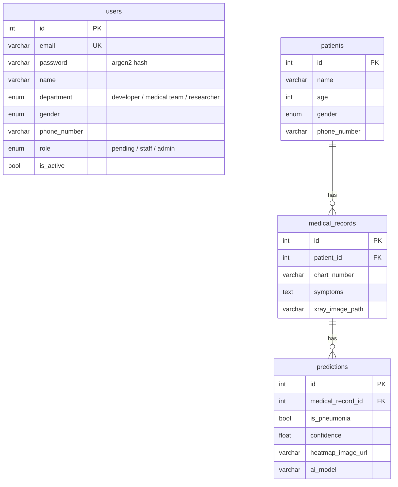

# 🩻 AI Health — 흉부 X-ray AI 폐렴 진단 지원 시스템

흉부 X-ray 이미지를 AI 모델로 분석해 **폐렴 여부를 예측**하는 의료진용 웹 서비스입니다.
사내 의료진·개발진·연구진이 환자와 진료기록을 관리하고, 진료기록에 등록된 X-ray로 AI 예측 결과를 확인할 수 있습니다.

<p align="center">
  
  
  
</p>
<p align="center"><sub>홈 · 환자 목록 · 회원 관리(관리자)</sub></p>

<br>

## 주요 기능

| 기능 | 설명 |
|---|---|
| **회원 · 인증** | 회원가입, 로그인(JWT), 토큰 자동 재발급, 마이페이지(정보 수정·비밀번호 변경·탈퇴) |
| **관리자 승인** | 가입 직후 `승인대기` 상태 → 관리자가 승인해야 서비스 이용 가능. 이름·이메일 검색, 부서 필터 |
| **환자 관리** | 환자 등록·조회·수정·삭제, 이름·성별·나이 범위 검색. 삭제 시 진료기록·예측결과·이미지까지 함께 삭제 |
| **진료기록** | 차트 번호·증상과 함께 흉부 X-ray 이미지 업로드, 환자별 진료기록 조회 |
| **AI 폐렴 예측** | 진료기록의 X-ray로 폐렴 여부(Positive/Negative)와 Confidence 예측, 예측 이력 조회 |

### 권한

| 권한 | 할 수 있는 일 |
|---|---|
| 승인대기 `pending` | 로그인만 가능 (관리자 승인 대기) |
| 스태프 `staff` | 환자·진료기록 조회, AI 예측 |
| 스태프 + 의료진 부서 | 위 기능 + 환자 등록·수정·삭제, 진료기록 등록 |
| 어드민 `admin` | 위 기능 + 회원 목록 조회, 권한 변경 |

<br>

## 기술 스택

| 구분 | 사용 기술 |
|---|---|
| Backend | Python 3.13, FastAPI, Pydantic v2 |
| Database | MySQL 8.0 (aiomysql), SQLite (로컬 테스트), SQLAlchemy 2.0 (async), Alembic |
| 인증 | JWT (PyJWT), argon2 비밀번호 해싱 |
| AI | PyTorch (CPU), Pillow, NumPy |
| Frontend | HTML / CSS / Vanilla JS (SPA) |
| Infra | Docker, Docker Compose, uv |

<br>

## 아키텍처

요청은 **API → Service → Repository → Model(DB)** 순서로 처리됩니다. 계층마다 역할을 나눠 결합도를 낮췄습니다.

```
 [Browser (static/)]
        │  fetch /api/v1/...
        ▼
 ┌───────────────────────────────────────────────────────────┐
 │ FastAPI (app/)                                            │
 │                                                           │
 │  apis/v1  ──▶  services  ──▶  repositories  ──▶  models   │──▶ MySQL
 │  (라우팅)      (비즈니스 로직)  (DB 조회·저장)     (ORM)     │
 │      │              │                                     │
 │  core/dependencies  └──▶ worker/model.py (AI 추론)         │
 │  (로그인·권한 확인)          └─ worker/models/*.pth        │
 └───────────────────────────────────────────────────────────┘
```

### ERD



<br>

## 구현 포인트

**🔐 JWT 인증 (Access 30분 / Refresh 7일)**
- Access Token은 응답 Body로, Refresh Token은 **HTTP-only 쿠키**로 전달해 JavaScript에서 접근할 수 없게 했습니다.
- 두 토큰을 서로 다른 비밀키로 서명해 Refresh Token을 Access Token으로 쓰지 못하게 했고, 페이로드에는 `user_id`만 담았습니다.
- Access Token이 만료되면 프론트엔드가 자동으로 재발급 받아 원래 요청을 다시 보냅니다.

**🧠 AI 모델 서빙**
- 모델은 요청마다 불러오지 않고 **서버 시작 시 한 번만 메모리에 로드**합니다 (FastAPI `lifespan`).
- 추론은 CPU를 오래 쓰는 동기 작업이라 `run_in_threadpool`로 별도 스레드에서 실행해, 추론 중에도 다른 요청이 막히지 않습니다.
- `UNIQUE(medical_record_id, ai_model)` 제약으로 **같은 진료기록·같은 모델의 결과는 한 번만 추론**하고, 이후에는 저장된 결과를 바로 응답합니다 (처음 `201`, 이후 `200`).
- 모델 파일이 없어도 서버는 정상 실행되고 예측 API만 `503`을 반환합니다.

**📦 사용 모델: SimpleCNN**
```
입력: 흑백(1채널) 128 × 128
Conv2d(1→16, 3×3) → ReLU → MaxPool(2)     # 128 → 64
Conv2d(16→32, 3×3) → ReLU → MaxPool(2)    # 64  → 32
Flatten(32×32×32) → Linear(32768 → 2)     # [정상, 폐렴]
```
제공된 모델 파일을 분석해 구조를 복원했습니다 (`worker/architecture.py`). 구조 포함 파일(`model.pth`)과 가중치 파일(`model_state_dict.pth`)을 모두 지원하며, GPU에서 저장된 모델을 CPU로 불러옵니다.

**🛡️ 입력 검증과 데이터 정합성**
- 비밀번호 규칙(대소문자·숫자·특수문자 포함 8자 이상), 휴대폰 번호 형식을 Pydantic으로 검증합니다.
- 업로드 이미지는 확장자뿐 아니라 **실제로 열어서** 이미지인지 확인하고, 파일명은 UUID로 바꿔 저장합니다.
- 환자 삭제 시 진료기록·예측결과는 DB `ON DELETE CASCADE`로, 업로드 이미지는 서비스 로직에서 함께 삭제합니다.

<br>

## 실행 방법

### 사전 준비
- [uv](https://docs.astral.sh/uv/) 설치
- **AI 모델 파일**: 과제에서 제공된 `model_state_dict.pth`(또는 `model.pth`)를 `worker/models/`에 넣습니다. (용량 문제로 저장소에는 포함하지 않았습니다.)

### 로컬 실행

```bash
# 1. 패키지 설치
uv sync

# 2. 환경변수 파일 생성 (Windows: copy .env.example .env)
cp .env.example .env
```

`.env`에서 DB를 선택합니다.
- **SQLite (간단)**: `DATABASE_URL=sqlite+aiosqlite:///./ai_health.db` 주석 해제
- **MySQL**: `docker compose up -d mysql`로 DB만 실행

```bash
# 3. 테이블 생성
uv run alembic upgrade head

# 4. 서버 실행
uv run fastapi run app/main.py
```

| 주소 | 내용 |
|---|---|
| http://localhost:8000 | 웹 화면 |
| http://localhost:8000/docs | Swagger UI (API 테스트) |
| http://localhost:8000/healthcheck | 서버·AI 모델 상태 (`ai_model_ready: true`) |

### 첫 관리자 계정 만들기

가입한 계정은 모두 `승인대기` 상태이므로, 웹에서 회원가입한 뒤 **프로젝트 폴더에서** 아래 명령으로 관리자로 지정합니다.

```bash
uv run python -m app.scripts.create_admin <가입한 이메일>
```

### Docker로 실행

```bash
docker compose up --build
```
`fastapi`와 `mysql` 컨테이너가 함께 실행되고, 시작 시 마이그레이션이 자동 적용됩니다.

<br>

## API

Base URL: `/api/v1` · 상세 명세는 서버 실행 후 [Swagger UI](http://localhost:8000/docs)에서 확인할 수 있습니다.

| 구분 | Method | Endpoint | 권한 |
|---|---|---|---|
| 회원 | POST | `/users/signup` | - |
| | POST | `/users/login` | - |
| | POST | `/users/refresh` | Refresh 쿠키 |
| | POST | `/users/logout` | - |
| | GET · PATCH · DELETE | `/users/me` | 로그인 |
| | PATCH | `/users/me/password` | 로그인 |
| 관리자 | GET | `/admin/users` | 관리자 |
| | PATCH | `/admin/users/role` | 관리자 |
| 환자 | POST | `/patients` | 의료진 |
| | GET | `/patients` | 승인된 유저 |
| | GET | `/patients/{id}` | 승인된 유저 |
| | PATCH · DELETE | `/patients/{id}` | 의료진 |
| 진료기록 | POST | `/medical-records` | 의료진 |
| | GET | `/patients/{id}/medical-records` | 승인된 유저 |
| | GET | `/medical-records/{id}` | 승인된 유저 |
| AI 예측 | POST | `/medical-records/{id}/predict` | 승인된 유저 |
| | GET | `/medical-records/{id}/analyses` | 승인된 유저 |

<br>

## 프로젝트 구조

```
├── app/
│   ├── main.py              # 앱 진입점 (라우터·정적파일 등록, AI 모델 로드)
│   ├── core/                # 설정, DB 연결, JWT·해싱, 권한 의존성
│   ├── models/              # SQLAlchemy 모델 (users, patients, medical_records, predictions)
│   ├── schemas/             # Pydantic 요청·응답 스키마
│   ├── repositories/        # DB 접근
│   ├── services/            # 비즈니스 로직
│   ├── apis/v1/             # API 라우터
│   ├── scripts/             # 관리자 계정 생성 스크립트
│   └── Dockerfile
├── worker/
│   ├── architecture.py      # 모델 구조 (SimpleCNN)
│   ├── model.py             # 모델 로드 및 추론
│   └── models/              # 모델 파일 (.pth) 위치
├── alembic/                 # DB 마이그레이션
├── static/                  # 프론트엔드
├── docs/                    # 과제 문서 · 스크린샷
├── docker-compose.yml
└── pyproject.toml · uv.lock
```

<br>

## 마이그레이션

```bash
uv run alembic revision --autogenerate -m "변경 내용"   # 모델 변경 → 마이그레이션 파일 생성
uv run alembic upgrade head                            # DB에 반영
uv run alembic downgrade -1                            # 한 단계 되돌리기
```
